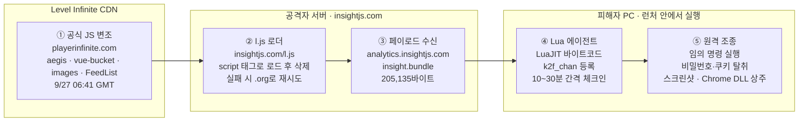
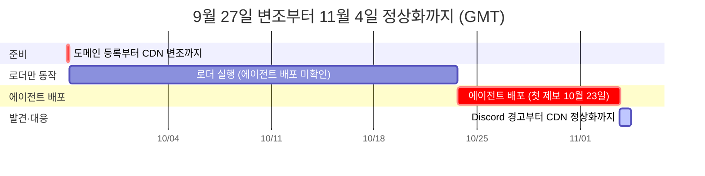

# NIKKE PC 런처 침해 사고 한눈에 보기 (2026년 11월)


**원문:** MotherSphere, [「NIKKE PC 런처 침해 사고 (2026년 11월)」](https://gist.github.com/MotherSphere/047beaf9e82d1ae52a1daec6e988379f) 한국어판(2026-11-04 23:18 GMT 판)과 첨부 문서 `target-paths_ko.md`를 그림과 표로 다시 정리한 요약본입니다. 이 요약과 원문이 다르면 원문을, 원문 번역본과 영어 원문이 다르면 영어 원문을 따르세요.

* 시각은 모두 **GMT**입니다. 한국 시간은 GMT에 9시간을 더하면 됩니다.
* **(제보)** 표시는 피해자 댓글이나 이슈에서 나왔지만 원문 작성자가 직접 확인하지 못한 내용입니다.


## 30초 요약

| 질문           | 답                                                                                                                                                                                      |
| ------------ | -------------------------------------------------------------------------------------------------------------------------------------------------------------------------------------- |
| 무슨 일이 있었나    | 9월 27일, Level Infinite 공식 CDN(`playerinfinite.com`, Tencent COS)의 JavaScript 파일 4개에 공격자 코드가 들어갔습니다. NIKKE PC 런처가 이 파일을 불러오면 **원격 제어 에이전트**가 설치될 수 있었습니다.                               |
| 언제부터         | 로더 코드는 **9월 27일**부터 들어 있었고, 에이전트는 늦어도 **10월 23일**부터 배포됐습니다(가장 이른 제보는 16:40). 런처를 열 때마다가 아니라 일부 실행에서만 받았습니다. 한 PC는 약 19번 실행 중 3번 받았습니다.                                                 |
| 누가 위험한가      | 늦어도 10월 23일부터 수정 시점까지 **Windows**나 **Linux·Steam Deck**(Proton)에서 NIKKE PC 런처를 연 모든 사람입니다. **Google Play Games 빌드**도 피해를 입었고(제보), 런처 캐시에 변조된 파일이 남아 있는 사람도 해당됩니다.                      |
| 무엇을 당할 수 있었나 | 임의 명령 실행, 모든 파일 열람·다운로드, 스크린샷, 비밀번호·브라우저 쿠키·토큰·SSH 키·암호화폐 지갑 탈취가 가능했습니다. Windows에서는 **런처를 닫아도 남는** Chrome DLL을 심을 수 있었습니다.                                                             |
| 지금 상태        | Level Infinite가 11월 4일 X에서 수정을 확인했습니다. 11월 4일 11:20 기준으로 확인한 CDN 서버 4곳 모두 정상이고, 공격자 서버는 11월 3일 18:31부터 응답하지 않습니다. **이미 감염된 PC는 이것으로 되돌아가지 않습니다.**                                      |
| 아직 모르는 것     | 공격자가 CDN 쓰기 권한을 어떻게 얻었는지 밝혀지지 않았습니다. 새 도메인으로 다시 시도할 가능성이 있습니다.                                                                                                                         |
| 지금 할 일       | ① [NIKKE Launcher Check](https://github.com/MotherSphere/NIKKE-Launcher-Check/releases/latest) 실행 → ② `tbs_cache` 백업 후 삭제 → ③ 도메인·IP 차단 유지. 흔적이 나오면 아래 **4. 대처 방법 › 감염된 경우** 단계를 따르세요. |

## 1. 공격은 이렇게 진행됐습니다




**결과: 늦어도 10월 23일부터 런처를 열기만 해도 감염될 수 있었습니다.** 에이전트의 명령은 런처 로그에 기록되지 않으므로, 어떤 명령이 실행됐는지 피해자가 알 수 없습니다. 감염됐다면 최악의 경우를 가정하고 대처하세요.


| 단계          | 어디서                       | 무슨 일이 일어났나                                                                                                                        |
| ----------- | ------------------------- | --------------------------------------------------------------------------------------------------------------------------------- |
| ① 공식 파일 변조  | Level Infinite CDN        | 공식 JS 파일 4개에 로더 코드가 삽입됐습니다(9월 27일 06:41\~06:42).                                                                                  |
| ② 로더 `l.js` | 공격자 서버 `insightjs.com`    | 삽입된 코드가 정수 배열에 숨긴 주소를 `<script>` 태그로 불러온 뒤 태그를 지웁니다. 실패하거나 30초 안에 응답이 없으면 `insightjs.org`로 다시 시도합니다.                              |
| ③ 페이로드 다운로드 | `analytics.insightjs.com` | `l.js`가 런처의 JS 브리지 `Srv_DownloadFile`로 `insight.bundle`(LuaJIT 바이트코드)을 받습니다. `Launcher\log\tinyget\`에 `.log` 이름으로 저장해 실행한 뒤 지웁니다. |
| ④ 에이전트 대기   | 피해자 PC (런처 내부)            | 에이전트는 `k2f_chan` 채널을 등록하고 서버 명령을 기다립니다. 체크인 간격은 서버가 정하며 10\~30분이었습니다.                                                             |
| ⑤ 원격 조종     | 피해자 PC                    | 서버가 보낸 명령으로 정보 탈취와 스크린샷, Chrome DLL 설치를 합니다. 통신은 모두 런처 내장 브라우저(`tbs_browser.exe`)를 거칩니다.                                          |

### 변조된 공식 파일 4개

| 파일                     | 대표 URL (호스트/경로)                                               | 불러오는 로더           | 정상 파일로 교체된 시각                                                 |
| ---------------------- | ------------------------------------------------------------- | ----------------- | ------------------------------------------------------------- |
| `aegis-fix.min.js`     | `sg-gpts.playerinfinite.com/comm/assets/lib/`                 | `l.js?f=aegis`    | 11/3 17:04 (`sg-gpts`), 17:13 (`na-webassets`)                |
| `vue-bucket.min.js`    | `na-webassets.playerinfinite.com/comm/assets/lib/`            | `l.js?f=vue`      | 11/3 17:04 (`sg-gpts`), 17:13 (`na-webassets`)                |
| `images.7fec4c32.js`   | `na-webassets.playerinfinite.com/comm/nikke_launcher/assets/` | `l.js?f=images`   | 11/3 17:23 (`sg-gpts`), 17:21 (`na-webassets`)                |
| `FeedList.feb647c9.js` | `na-webassets.playerinfinite.com/comm/nikke_launcher/assets/` | `l.js?f=feedlist` | 원본 서버는 10/28 15:46. 일부 CDN 서버는 **11/4 03:12\~03:21**까지 변조본 제공 |


`sg-gpts` 쪽 사본(`images`, `FeedList`, `vue-bucket`)도 변조된 것으로 제보됐습니다. 11월 4일부터 런처는 다시 빌드한 프런트엔드를 불러오지만 `FeedList.feb647c9.js`는 URL이 그대로입니다. **런처 캐시(`tbs_cache`)를 지워야 하는 이유**가 이것입니다.


## 2. 타임라인



| 구간      | 기간 (GMT)                 | 요약                                                                       |
| ------- | ------------------------ | ------------------------------------------------------------------------ |
| 준비      | 9/27 01:59 \~ 06:42      | 도메인 등록, 인증서 발급, 서버 가동을 거쳐 CDN 파일 변조까지 약 4시간 40분이 걸렸습니다.                  |
| 로더만 동작  | 9/27 \~ 10/23            | 런처가 로더를 실행했습니다(9월 30일 첫 조회 제보). 이 기간의 에이전트 배포는 확인되지 않았습니다.               |
| 에이전트 배포 | 10/23 \~ 11/3            | 10월 23일 16:40에 첫 에이전트 실행이 제보됐습니다. 10월 31일부터 11월 3일까지 페이로드 빌드 7개가 올라왔습니다. |
| 발견·대응   | 11/3 16:11 \~ 11/4 11:20 | Discord 경고, 파일 교체, 공격자 서버 중단, CDN 정상화, 공식 발표 순으로 진행됐습니다.                 |

<details>

<summary>주요 사건 16개</summary>

| 시각 (GMT)             | 구분 | 사건                                         |
| -------------------- | -- | ------------------------------------------ |
| 09-27 01:59          | 공격 | `insightjs.com` 도메인 등록                     |
| 09-27 06:41          | 공격 | Level Infinite CDN 공식 파일 4개 변조             |
| 09-30                | 피해 | 로더의 `insightjs.com` 조회가 처음 기록됨 (제보)        |
| 10-06 00:55          | 공격 | `analytics.insightjs.com` 인증서 발급           |
| 10-23 16:40          | 피해 | 에이전트 실행이 처음 기록됨 (제보)                       |
| 10-28 15:46          | 대응 | 원본 서버의 `FeedList` 정상화. 일부 CDN 서버에는 변조본이 남음 |
| 10-31 \~ 11-03       | 공격 | 페이로드 빌드 7개 연속 업로드 (ETag 기준)                |
| 11-03 16:11          | 대응 | NIKKE 커뮤니티 Discord에 첫 공개 경고                |
| 11-03 17:04 \~ 17:23 | 대응 | Level Infinite가 변조 파일 3개 교체                |
| 11-03 17:30          | 공격 | 공격자의 `l.js`가 무해해 보이는 분석 스크립트로 바뀜           |
| 11-03 17:55          | 대응 | 제3자가 `insightjs.org`를 등록해 경고 페이지로 사용       |
| 11-03 18:31          | 대응 | 공격자 서버 `89.127.233.127` 응답 중단              |
| 11-04 00:48          | 피해 | 일부 CDN 서버가 여전히 변조된 `FeedList` 제공           |
| 11-04 03:12 \~ 03:21 | 대응 | 확인한 CDN 서버 4곳이 정상 `FeedList`를 받음           |
| 11-04 03:13          | 대응 | Level Infinite가 X에 공식 발표                   |
| 11-04 11:20          | 대응 | 확인한 CDN 서버 4곳 모두 파일 4개 정상                  |

</details>

## 3. 내 PC는 감염됐을까?

**가장 쉬운 방법:** [NIKKE Launcher Check](https://github.com/MotherSphere/NIKKE-Launcher-Check/releases/latest)를 실행하세요. Windows·Linux·macOS를 지원하고 파일을 읽기만 하며 PC 밖으로 아무것도 보내지 않습니다. 흔적 일부가 캐시에 있으므로 **`tbs_cache`를 지우기 전에** 실행해야 합니다.

### 직접 확인하는 곳

가장 먼저 볼 곳은 `debug.log`입니다. 아래는 `k2f_chan`을 찾았을 때의 예시이며, 실제 로그와 형식이 다를 수 있습니다.


```
101  ... 정상 실행 기록 ...
102  FETCH_LIST suc success                                  ← 정상 모듈의 기록 · 감염 징후 아님
103  startup already in progress                             ← 있을 수도, 없을 수도 있음
104  lua downloaded to log\tinyget\tinyget.<timestamp>.log
105  k2f_chan registered                                     ← 이 문자열이 있으면 감염
106  adopted <uuid>                                          ← 이 줄이 없어도 감염
107  agent started as <컴퓨터 이름>
108  ... 이후 기록 ...
```



**`k2f_chan`이 있다 → 감염으로 보고 아래 감염된 경우 대처 단계를 따르세요.** 못 찾았다고 끝이 아닙니다. `Launcher\log\tinyget` 로그의 `insight.bundle` 다운로드 완료 기록, `tbs_cache`의 Code Cache 로더 항목과 Local Storage의 `k2f.agent`, 공유기·DNS의 `insightjs.com` 조회 기록도 확인하세요.


| 확인할 곳                                               | 찾을 것                                                                                                                 | 뜻                                                                              | 판단                         |
| --------------------------------------------------- | -------------------------------------------------------------------------------------------------------------------- | ------------------------------------------------------------------------------ | -------------------------- |
| `NIKKE 설치 폴더\Launcher\intl_service\debug.log`       | `k2f_chan`                                                                                                           | 에이전트가 실행됐습니다. 뒤에 `adopted`, `agent started as` 줄이 없어도 같습니다.                    | **감염 확정**                  |
| 같은 파일                                               | `k2f_chan registered` 바로 뒤의 `startup failed: EIO: invalid UTF-8 in string`                                           | Windows 사용자 이름에 ASCII가 아닌 문자가 있어 에이전트가 ID를 받기 전에 멈춘 것으로 보입니다. 이후 동작은 알 수 없습니다. | **감염으로 대응**                |
| `Launcher\log\tinyget\tinyget.*.log`                | `insight.bundle` 작업에 이어지는 `curl perform success`와 `OnDownloadResult ... result=0 ... total=205135`(또는 0이 아닌 total)   | 페이로드 다운로드가 끝났습니다.                                                              | 강한 신호                      |
| 같은 파일                                               | `AddTask`만 있거나 `curl_error`, `result=2`, `total=0`                                                                   | 실패한 다운로드 시도입니다. 이 요청으로는 에이전트가 오지 않았습니다.                                        | 다운로드 아님                    |
| `Launcher\log\tinyget\` 폴더                          | `1B 4C 4A 01` 바이트로 시작하는 파일 (예: `k2f.lua`)                                                                            | 크기나 이름과 관계없이 에이전트 본체입니다.                                                       | **감염 확정**                  |
| `tinyget.mem.log`                                   | `na.fleetlogd.com`으로 가는 POST에 붙은 `Referer: https://analytics.insightjs.com/`                                         | 보조 신호입니다.                                                                      | 보조                         |
| `%APPDATA%\nikke_launcher\tbs_cache\Code Cache\js\` | `dd65fa4d61079e7e_0`(aegis), `ce2fd3f1007a9fe9_0`(images), `1416c638b3830103_0`(feedlist), `fd520c7c0f65c2d7_0`(vue) | 로더가 실행됐습니다. 타임스탬프는 마지막 실행 시각입니다.                                               | 로더 실행                      |
| `tbs_cache\Local Storage\leveldb\`                  | `k2f.agent`                                                                                                          | 에이전트가 상태를 저장했습니다. 압축된 `.ldb`에 있으면 텍스트 검색으로 안 보일 수 있습니다.                        | 있으면 **감염 확정**, 없으면 약한 증거   |
| `tbs_cache\TransportSecurity`                       | `insightjs.com` 호스트                                                                                                  | HSTS 기록입니다. `analytics.`의 `sts_observed`는 대개 마지막 에이전트 체크인 시각입니다.               | 보조                         |
| DNS·공유기 로그                                          | `insightjs.com` / `analytics.insightjs.com` 조회                                                                       | 로더 실행 / 에이전트 단계까지 갔을 가능성이 높습니다.                                                | 다른 DNS 경로가 있으면 기록이 빠질 수 있음 |
| 레지스트리·Chrome 폴더                                     | 아래 **감염된 경우** 2·4단계의 지속성 장치                                                                                          | Chrome DLL이 설치됐습니다.                                                            | **감염 확정**                  |
| 백신                                                  | Malwarebytes `Trojan.Loader.K2F`(Code Cache), `Trojan.Trace.K2F`(Local Storage) (제보)                                 | `tbs_cache`의 흔적을 탐지한 것입니다.                                                     | 지우면 증거만 사라짐                |


런처는 `debug.log`에 기록을 계속 덧붙입니다. NIKKE 폴더를 지웠거나 다시 설치했다면 이 파일은 남아 있지 않습니다.


### 감염 신호로 오해하기 쉬운 것

| 보이는 것                                      | 판단                                                               |
| ------------------------------------------ | ---------------------------------------------------------------- |
| `FETCH_LIST suc success`                   | 정상 FeedList 모듈이 남기는 기록입니다. 감염 징후가 아닙니다.                          |
| `startup already in progress`              | 감염된 실행에도 없는 경우가 있습니다. 있든 없든 믿을 만한 신호가 아닙니다.                      |
| `%LOCALAPPDATA%\Temp\onominan.tmp` (22바이트) | Tencent 소프트웨어가 만든 파일입니다. 감염 표시가 아닙니다(원문 이전 판의 오류를 정정한 내용).       |
| `PlatformExperienceHelper` 폴더 자체           | Chrome의 정상 폴더입니다. 그 안에 DLL이 든 **64자리 16진수 이름의 하위 폴더**만 악성입니다.    |
| HKLM 아래 같은 CLSID (`wpc.dll`)               | 정상입니다. 악성은 **HKCU** 쪽 키뿐입니다.                                     |
| 설정의 `collect_cookies: false`               | 쿠키가 안전했다는 뜻이 아닙니다. `cat`, `download`, `exec`로 쿠키 파일을 복사할 수 있습니다. |
| `%TEMP%`에 `k2f-*` 임시 파일이 없음                | 읽은 직후 지워지므로 아무것도 증명하지 않습니다.                                      |
| SRUM에 트래픽 급증이 없음                           | 급증이 없었던 감염 PC도 있습니다. 이것만으로 감염을 배제할 수 없습니다.                       |
| 백신 검사 결과가 깨끗함                              | Microsoft Defender Offline이 DLL을 놓친 사례가 있습니다(시그니처 1.463.110.0).  |


**로그를 공유하기 전에:** `Cookie` 줄과 `login_ticket`, `biz_ticket`, `uid`, `openid`, `sig` 값을 지우세요. `path=` 필드에 Windows 사용자 이름이 보일 수도 있습니다. 제보는 [NIKKE-Launcher-Check 이슈](https://github.com/MotherSphere/NIKKE-Launcher-Check/issues)로 하면 됩니다.


## 4. 대처 방법


**흔적을 지우기 전에 먼저 점검하세요.** Level Infinite는 11월 4일 수정을 확인했지만, 이미 감염된 PC는 저절로 되돌아가지 않습니다. 흔적이 하나라도 나왔다면 아래 **감염된 경우** 단계를 위에서부터 진행하세요.


### 모든 사용자

| 순서 | 할 일                         | 자세히                                                                                             |
| -- | --------------------------- | ----------------------------------------------------------------------------------------------- |
| 1  | **NIKKE Launcher Check 실행** | `tbs_cache`를 지우기 전에 실행하거나, 폴더를 안전한 곳에 복사해 두세요. 에이전트 실행 흔적(`k2f.agent.state`, HSTS)이 이 폴더에 있습니다. |
| 2  | **`tbs_cache` 삭제**          | 런처를 **다시 열기 전에** 지우세요. 변조된 파일이 남아 있으면 런처가 다시 불러옵니다. 경로는 아래 표에 있습니다.                             |
| 3  | **도메인·IP 차단 유지**            | hosts 파일, 공유기, 방화벽 중 하나에서 아래 목록을 차단하세요. 지금 있는 서버만 막아 주므로 새 도메인은 막지 못합니다.                        |

| 런처 종류                     | 캐시 폴더                                                                 |
| ------------------------- | --------------------------------------------------------------------- |
| 일반                        | `%APPDATA%\nikke_launcher\tbs_cache`                                  |
| HMT                       | `%APPDATA%\nikke_launcher_hmt\tbs_cache`                              |
| Google Play Games         | `%APPDATA%\nikke_launcher_google\tbs_cache` (설치 위치 `C:\NIKKE_GOOGLE`) |
| Proton (Linux·Steam Deck) | 위 경로가 프리픽스 안에 있습니다                                                    |


```
insightjs.com
analytics.insightjs.com
insightjs.org
89.127.233.127
89.126.250.172
```


### 감염된 경우

| 순서 | 할 일                                                                                                                                           | 주의할 점                                                                    |
| -- | --------------------------------------------------------------------------------------------------------------------------------------------- | ------------------------------------------------------------------------ |
| 1  | 런처를 닫거나 인터넷 연결을 끊습니다                                                                                                                          | 공격자의 접근부터 막습니다.                                                          |
| 2  | `HKCU\Software\Classes\CLSID\{E77CC89B-7401-4C04-8CED-149DB35ADD04}` 키를 삭제합니다                                                                 | 기본값이 비어 있어도 키가 있으면 지웁니다. HKLM 아래 같은 CLSID는 정상(`wpc.dll`)이니 그대로 둡니다.      |
| 3  | Windows를 다시 시작합니다                                                                                                                             | DLL은 로드된 동안 잠겨 있습니다. Chrome 창을 모두 닫아도 마찬가지입니다(제보).                       |
| 4  | `%LOCALAPPDATA%\Google\Chrome\User Data\PlatformExperienceHelper\` 안에서 **64자리 16진수 이름**이면서 `platform_experience_helper.dll`이 든 하위 폴더를 모두 지웁니다 | `PlatformExperienceHelper` 폴더 전체를 지우면 안 됩니다.                             |
| 5  | 가능하면 **Windows를 다시 설치**합니다                                                                                                                    | 에이전트가 살아 있는 동안 공격자는 어떤 명령이든 실행할 수 있었습니다.                                 |
| 6  | **감염되지 않은 기기에서** 비밀번호를 바꾸고 2단계 인증을 켭니다                                                                                                        | NIKKE·Level Infinite를 먼저, 그다음 이메일, Discord, 은행, 브라우저에 저장된 모든 비밀번호 순서입니다. |
| 7  | 모든 세션에서 로그아웃합니다                                                                                                                               | Discord, Google, Steam, GitHub 등. 훔친 쿠키는 비밀번호 없이도 작동합니다.                 |
| 8  | API 토큰, SSH 키, 개발자 자격 증명을 폐기하고 다시 발급합니다                                                                                                       | GitHub, npm, AWS, OpenAI, Anthropic 등이 대상입니다.                            |
| 9  | 암호화폐는 **새 시드 구문**으로 만든 새 지갑으로 옮깁니다                                                                                                            | 기존 시드 구문이 노출됐을 수 있습니다.                                                   |


런처 매니페스트가 관리자 권한(`requireAdministrator`)을 요청한다는 제보가 있습니다. 표준 사용자 계정에서 다른 계정의 관리자 비밀번호를 입력해 런처를 실행했다면, **그 관리자 계정**의 `%APPDATA%\nikke_launcher`, `%TEMP%`, HKCU CLSID 키도 확인하세요.


## 5. 감염된 PC에서 공격자가 할 수 있었던 일

에이전트는 정해진 작업만 하는 탈취 도구가 아니라 **공격자가 조종하는 원격 제어 도구**입니다. 런처가 열려 있는 동안 서버가 아래 명령을 보낼 수 있었습니다.

| 명령                                                    | 하는 일                                                     | 참고                                                                  |
| ----------------------------------------------------- | -------------------------------------------------------- | ------------------------------------------------------------------- |
| `exec`                                                | 임의의 프로그램이나 셸 명령을 실행하고 출력을 받습니다                           | 새 프로세스를 만드는 유일한 명령입니다. 이것 하나로 사용자 계정이 할 수 있는 모든 일이 가능합니다.           |
| `ls` `cd` `cat` `download` `file_chunk`               | 폴더 탐색, 파일 다운로드                                           | 어떤 파일이든 가져갈 수 있습니다.                                                 |
| `screens`                                             | 모든 모니터의 스크린샷                                             | `%TEMP%\k2f_screen_<시각>_<n>.jpg`로 저장한 뒤 바로 지웁니다.                    |
| `creds`                                               | 런처에 저장된 NIKKE 계정·비밀번호 복호화                                | `psd.dat`, `last_user.dat` (`nikke_launcher`, `nikke_launcher_hmt`) |
| `browserscan`                                         | Chrome·Edge·Brave·Vivaldi·Opera·Firefox의 저장된 비밀번호        | 쿠키는 Chromium 계열에서만 가져오고, Opera GX는 건너뛸 가능성이 높습니다. 복호화는 서버에서 합니다.    |
| `chrome_scan`                                         | Chrome 설치 위치, 프로필, 확장 프로그램 ID 나열                         |                                                                     |
| `keyscan`                                             | 자격 증명·설정 파일 경로 264개와 Windows 자격 증명 관리자의 개발 도구 항목         | `git:` `gh:` `npm:` `docker:` `aws:` `azure:` `vscode:` 등           |
| `wallet_files`                                        | 암호화폐 지갑 확장 프로그램 28종의 데이터                                 | Chrome 프로필만 대상입니다. 다른 브라우저 지갑은 `download`로 가져갈 수 있습니다.              |
| `whoami` `sysinfo` `host_facts`                       | 컴퓨터 이름, 사용자, 권한 수준, Windows 빌드, CPU, RAM, 드라이브, 네트워크 어댑터 |                                                                     |
| `chrome_install`                                      | Chrome DLL 지속성 장치 설치                                     | Chrome이 설치돼 있지 않아도 설치됩니다. DLL은 피해자마다 해시가 다릅니다.                      |
| `chrome_cleanup` `chrome_uninstall` `payload_cleanup` | 흔적 삭제                                                    |                                                                     |

| 알아 둘 점            | 내용                                                                                                                                |
| ----------------- | --------------------------------------------------------------------------------------------------------------------------------- |
| 기록이 안 남음          | 어떤 명령도 런처 로그에 기록되지 않습니다. 감염됐다면 **최악의 경우를 가정**하세요.                                                                                 |
| 빠른 첫 명령           | 첫 명령은 에이전트 시작 후 몇 초 안에 왔습니다. Chrome DLL이 시작 3초 뒤에 저장된 사례가 있습니다.                                                                   |
| 유출량 사례 (제보, SRUM) | 25분 동안 4.85 MB, 처음 5분 동안 약 1.2 MB, 시작 직후 약 947 KB, 1시간 동안 146 MB                                                                  |
| 활동 시간             | 런처가 열려 있는 동안 계속 활성입니다. 런처는 게임 중에도 알림 영역에 남는 경우가 많습니다. 9시간 동안 22번 체크인한 에이전트가 있었습니다(제보).                                            |
| 관리자 권한            | 런처가 관리자 권한으로 실행되면(제보) 에이전트도 같은 권한을 얻습니다. Chrome·Edge의 앱 바인딩 암호화를 SYSTEM 토큰으로 푸는 경로도 동작할 수 있습니다.                                   |
| 숨는 방식             | `exec`를 뺀 명령은 런처 프로세스 안(LuaJIT FFI)에서 실행되므로 Prefetch나 프로세스 생성 로그에 나타나지 않습니다.                                                      |
| 없는 기능             | 예약 작업, Run 키, 서비스, WMI, 시작프로그램 폴더용 코드는 없습니다. 이런 곳에 무언가 있다면 `exec`로 만든 것입니다.                                                       |
| 유출량 확인            | `C:\Windows\System32\sru\SRUDB.dat`(SRUM)를 NirSoft NetworkUsageView나 SrumECmd로 열어, 에이전트 시작 시간대의 `tbs_browser.exe` 전송량을 평소와 비교합니다. |

## 6. 에이전트가 노린 정보

원문 첨부 문서 `target-paths_ko.md`는 `insight.bundle`에서 디코딩한 대상 목록입니다.

| 목록                                                 | 개수  |
| -------------------------------------------------- | --- |
| 파일과 폴더                                             | 250 |
| 파일 경로로 읽는 환경 변수                                    | 16  |
| 브라우저 프로필 하위 경로                                     | 15  |
| 레지스트리 키                                            | 7   |
| 스캔 중에 찾는 파일 이름·확장자                                 | 39  |
| keyscan이 건너뛰는 경로 부분 (`\ChatSessions\`, `\Skills-`) | 2   |

| 분류        | 대표 대상                                                                                                                                                                                                                                                   |
| --------- | ------------------------------------------------------------------------------------------------------------------------------------------------------------------------------------------------------------------------------------------------------- |
| SSH·원격 접속 | `~\.ssh\*`(`known_hosts` 포함), 레지스트리의 PuTTY·WinSCP 세션, FileZilla `sitemanager.xml`·`recentservers.xml`                                                                                                                                                   |
| GPG       | `%APPDATA%\gnupg`, `private-keys-v1.d`                                                                                                                                                                                                                  |
| AI 도구     | Claude(`~\.claude\.credentials.json`, `claude_desktop_config.json`), Codex `auth.json`, Gemini CLI `oauth_creds.json`, GitHub Copilot CLI, Cursor, Windsurf, VS Code(`state.vscdb`, `mcp.json`), Kimi, Qwen Code, OpenCode, Aider, Continue.dev         |
| 클라우드      | AWS(`~\.aws\credentials`, SSO 캐시), Azure, Google Cloud, Oracle Cloud, DigitalOcean, Hetzner, Linode, Alibaba, Tencent, Huawei, Fly.io, Railway, Vercel, Netlify, Cloudflare Wrangler, Supabase, Neon, PlanetScale, MongoDB Atlas, Snowflake, Databricks |
| 개발 도구     | GitHub CLI `hosts.yml`, GitLab CLI, npm, pip, Poetry, Cargo, Composer, NuGet, RubyGems, Gradle, Maven, Docker·Podman `auth.json`, Kubernetes, Helm, Terraform, Pulumi, Stripe, Twilio, Sentry, Hugging Face, Kaggle                                     |
| 셸 기록      | PowerShell `ConsoleHost_history.txt`, `.bash_history`, `.zsh_history`, fish, psql, MySQL, Python·Node REPL 기록                                                                                                                                           |
| 프로젝트 폴더   | `%USERPROFILE%`의 `code`, `dev`, `source`, `Programming`, `Documents`, `Desktop`에서 `.env`, `appsettings*.json`, `application*.yml`, `docker-compose.yml`, `.mcp.json` 검색                                                                                 |
| 브라우저      | Chrome·Edge·Brave·Vivaldi·Opera의 `Cookies`, `Login Data`, `Local State` / Firefox의 `key4.db`, `logins.json`                                                                                                                                             |
| NIKKE     | `%APPDATA%\nikke_launcher`, `%APPDATA%\nikke_launcher_hmt`                                                                                                                                                                                              |
| 환경 변수     | 설정 파일을 가리키는 변수 38개 (`$CLAUDE_CONFIG_DIR`, `$GH_CONFIG_DIR`, `$AWS_SHARED_CREDENTIALS_FILE`, `$KUBECONFIG`, `$DOCKER_CONFIG` 등)                                                                                                                          |
| 암호화폐 지갑   | MetaMask, Phantom, Coinbase, Binance, OKX, Bybit, Bitget, Trust, Rabby, Rainbow, Keplr, Solflare, Backpack, Tonkeeper, TronLink, Xverse, UniSat, Petra, Ronin, Magic Eden 등 브라우저 확장 28개                                                                 |
| 레지스트리     | PuTTY·WinSCP 세션, GnuPG, 시스템 환경 변수, CPU와 Windows 버전 정보, 지속성용 CLSID 키                                                                                                                                                                                     |


개발자라면 이 목록에 있는 도구의 토큰은 모두 노출됐다고 보고 **4. 대처 방법 › 감염된 경우**의 8단계를 진행하세요. 전체 경로는 원문 `target-paths_ko.md`에 있습니다.


## 7. Linux · Steam Deck (Proton)

| 항목     | 내용                                                                                                                                                                            |
| ------ | ----------------------------------------------------------------------------------------------------------------------------------------------------------------------------- |
| 안전한가   | **아닙니다.** Proton을 써도 안전하지 않습니다.                                                                                                                                               |
| 자동 스캔  | Windows 경로를 찾기 때문에 프리픽스 안에서는 거의 찾지 못합니다. 분석한 PC에서 프리픽스 안의 대상은 NIKKE 런처 데이터뿐이었습니다.                                                                                             |
| 원격 명령  | Wine은 Linux 홈 폴더와 `/`를 드라이브 문자(최소 `Z:`)로 연결합니다. 공격자는 `exec`, `ls`, `cat`, `download`로 Linux 사용자가 읽을 수 있는 것을 모두 읽을 수 있습니다: `~/.ssh`, 브라우저 프로필, API 키가 든 셸 설정 파일, 비밀번호 저장소, 문서. |
| 환경 변수  | 게임에 그대로 전달되며 에이전트가 모두 읽습니다.                                                                                                                                                   |
| 지속성 장치 | Windows용 Chrome DLL은 Linux에 해당하지 않습니다.                                                                                                                                        |
| 결론     | 홈 폴더와 환경 변수에 있는 모든 비밀 정보가 노출됐다고 간주하세요.                                                                                                                                        |

## 8. 침해 지표 (IOC)

### 네트워크

| 종류  | 값                         | 비고                                                                               |
| --- | ------------------------- | -------------------------------------------------------------------------------- |
| 도메인 | `insightjs.com`           | 2026-09-27 01:59 등록. 2017\~2022년에 쓰이다 만료된 도메인을 다시 등록한 것이며, 이전 소유자와의 관련 근거는 없습니다. |
| 도메인 | `analytics.insightjs.com` | 페이로드 배포와 체크인에 쓰였습니다.                                                             |
| 도메인 | `insightjs.org`           | 로더의 대체 도메인입니다. 11월 3일 17:55에 제3자가 등록했고, 지금은 다국어 경고 페이지를 보여 줍니다.                  |
| IP  | `89.127.233.127`          | 1984 ehf(아이슬란드) VPS. 10월 21\~23일경부터 사용했고, 11월 3일 18:31부터 응답하지 않습니다.              |
| IP  | `89.126.250.172`          | 같은 1984 ehf 네트워크. 10월 21일경까지 사용했습니다(제보).                                         |

```
https://insightjs.com/l.js?f=aegis
https://insightjs.com/l.js?f=images
https://insightjs.com/l.js?f=feedlist
https://insightjs.com/l.js?f=vue
https://analytics.insightjs.com/comm/assets/insight.bundle
https://analytics.insightjs.com/px/<32자리 16진수>   (Chrome DLL, 16진수는 에이전트 ID)
```

### 변조된 공식 파일

| 파일                     | 변조본 크기     | 변조본 ETag                           | 정상본 크기     | 정상본 ETag                           |
| ---------------------- | ---------- | ---------------------------------- | ---------- | ---------------------------------- |
| `aegis-fix.min.js`     | 69,731바이트  | `50d1861152ea7f6875ffceb7d08445b5` | 69,033바이트  | `44c576454a5b0b4ed60e1a983aa4e782` |
| `images.7fec4c32.js`   | 4,358바이트   | `481e9b5ab8fb93406bf31980b53e0578` | 3,660바이트   | `6e5f79cf9b7c364249f9de83ba7fa59e` |
| `FeedList.feb647c9.js` | 5,808바이트   | `b7d842200372ad0d9a84ef4cc8511311` | 5,099바이트   | `04ee9800128396ba26f10ca70f170967` |
| `vue-bucket.min.js`    | 135,273바이트 | `dd06875637a29cddd3bae2ba84142c78` | 134,592바이트 | `63bc3a47b35b80a5d200dc5624d7126e` |

```
# 변조본 SHA-256
04471ccf9f6ebac477ba4ca6b408a56621bccd16118c3112720adb35e6422e3d  aegis-fix.min.js
21d2fa4b6cdd15da3d5246687a01ef84fb848668144258b110606db5eb5ea7ce  images.7fec4c32.js
2f2aac505f486067af6831d6c75ea74df63acb1ed4e4002709c5962c68bd9203  FeedList.feb647c9.js
3aaafbd612f04501a6fdb0bb8b2f8a87796223e5584ac18ea5eb180feeafb193  vue-bucket.min.js

# 정상본 SHA-256
83bb8f30c65fd31208089f4107f316e7073c9b1213a8a3b2b512ab99e261de18  aegis-fix.min.js
4ad53349f98b86fd3a97bc386b2a1f555baf27c27a270f272404d47c9d7cc065  images.7fec4c32.js
49b625b30b34dc1fa16edba30bdf63c18b6171a0fc4cf030e21ea4e1263ae18a  FeedList.feb647c9.js
459343517635a96caa109b050361b4d32393e8727b2f54b44749db783feb4199  vue-bucket.min.js
```

### 페이로드 (`insight.bundle`) 빌드

nginx ETag는 `16진수 수정 시각-16진수 크기` 형식입니다. 크기 `3214f`는 205,135바이트입니다.

| 업로드 시각 (GMT)   | ETag             | 비고                                                                         |
| -------------- | ---------------- | -------------------------------------------------------------------------- |
| 10/23 무렵       | 알 수 없음           | `Launcher\log\tinyget\k2f.lua`로 디스크에 남음. 165,108바이트, 명령 19개 중 14개만 있음 (제보) |
| 10/31 15:38:43 | `6ae60b83-3214f` | 17:20에 이 빌드로 에이전트 시작 (제보)                                                  |
| 11/1 01:06:14  | `6ae69086-3214f` | 제보                                                                         |
| 11/1 18:08:55  | `6ae78037-3214f` | 제보 3건                                                                      |
| 11/2 17:48:47  | `6ae8ccff-3214f` | 제보                                                                         |
| 11/2 21:48:40  | `6ae90538-3214f` | 분석 대상 PC에서 실행된 빌드                                                          |
| 11/3 12:31:04  | `6ae9d408-3214f` | 14:19에 이 빌드로 에이전트 시작 (제보)                                                  |
| 11/3 14:56:40  | `6ae9f628-3214f` | 공개 샘플                                                                      |

```
# 페이로드 SHA-256
cc0ad05bfe85940a6067b3a72c182d3953339129206634141926d5d0b35973ec  11/3 16:22 사본, 205,135바이트
60fd53ab7356384ba2161b9bc84420cd170905011a2f3ca09f3e38fe3122f3a1  10/23 빌드 k2f.lua, 165,108바이트 (제보)
# 해시가 달라도 Launcher\log\tinyget 안에서 1B 4C 4A 01로 시작하는 파일은 에이전트입니다
```

### PC에 남는 흔적

| 종류                   | 위치 / 값                                                                                                                                |
| -------------------- | ------------------------------------------------------------------------------------------------------------------------------------- |
| 로그 문자열 (`debug.log`) | `k2f_chan registered`, `adopted`, `resuming`, `agent started as`, `lua downloaded to log\tinyget\`                                    |
| 로더 캐시                | `tbs_cache\Code Cache\js\` 안 `dd65fa4d61079e7e_0`, `ce2fd3f1007a9fe9_0`, `1416c638b3830103_0`, `fd520c7c0f65c2d7_0`                   |
| 에이전트 상태              | `%APPDATA%\nikke_launcher\tbs_cache\Local Storage\leveldb\*.log` 또는 `*.ldb` 안의 `k2f.agent.state` (NIKKE 폴더를 지워도 남음)                   |
| 지속성 DLL              | `%LOCALAPPDATA%\Google\Chrome\User Data\PlatformExperienceHelper\<sha256>\platform_experience_helper.dll`                             |
| 지속성 레지스트리            | `HKCU\Software\Classes\CLSID\{E77CC89B-7401-4C04-8CED-149DB35ADD04}\InprocServer32`                                                   |
| 임시 파일 (사용 직후 삭제)     | `%TEMP%\k2f-bcreds-<unix time>-<random>.db`, `%TEMP%\k2f_screen_<unix time>_<n>.jpg`, `%TEMP%\k2f-keyscan-<time>-<rand>.db`(10/23 빌드) |


DLL은 피해자마다 따로 만들어지므로 해시로는 찾을 수 없습니다. 경로와 레지스트리 키로 찾으세요.


## 9. 아직 풀리지 않은 문제

| 문제                    | 왜 중요한가                                                                               |
| --------------------- | ------------------------------------------------------------------------------------ |
| 공격자가 CDN 쓰기 권한을 얻은 경로 | 이 경로가 막히지 않으면 새 도메인을 쓰는 새 로더가 언제든 다시 배포될 수 있습니다.                                     |
| 런처 캐시에 남은 예전 파일       | 11월 4일 프런트엔드에서도 `FeedList.feb647c9.js`는 URL이 그대로입니다. 그래서 지금도 `tbs_cache`를 지워야 합니다.   |
| 공식 발표에 사용자 안내가 없음     | 11월 4일 발표는 파일 이름, 페이로드, 사용자 조치를 밝히지 않았습니다. 영향은 조사 중이라고만 했습니다.                        |
| 공격자 도메인이 아직 살아 있음     | 11월 4일 22:59에도 `insightjs.com`과 `analytics.insightjs.com`은 `89.127.233.127`로 조회됐습니다. |
| 같은 버킷의 다른 파일          | 같은 CDN 호스트가 Level Infinite의 다른 웹 서비스도 제공합니다. 실제로 손댄 증거는 없지만 빌드 결과물과 대조가 필요합니다.       |

원문 작성자가 Level Infinite에 요청한 내용은 세 가지입니다. 다음 런처 업데이트에서 캐시를 강제로 초기화할 것, 같은 버킷의 다른 파일을 빌드 결과물과 대조할 것, CDN 쓰기 권한을 얻은 경로를 찾아 막을 것.

## 10. 기술 메모

| 항목      | 내용                                                                                                                                                                          |
| ------- | --------------------------------------------------------------------------------------------------------------------------------------------------------------------------- |
| 에이전트 형식 | LuaJIT 2.0 바이트코드(32비트, strip 처리), Prometheus로 난독화. 문자열은 순서를 섞은 테이블에 자체 base64·base85로 저장. 내부 빌드 이름 `K2F_LUA_BUILD`                                                          |
| 통신 구조   | Lua 에이전트에는 네트워크 코드가 없습니다. `k2f_chan`으로 들어오는 JSON 요청(`open`, `read`, `write`, `ping`, `close`)에만 응답하고, 출력은 base64로 최대 2 MiB씩 돌려줍니다. 실제 통신은 `tbs_browser.exe` 안의 `l.js`가 합니다. |
| 상태 값    | `k2f.agent.state`에 `agent_id`, `agent_pass`, `c2s_counter`, `s2c_counter`, `poll_interval_seconds`(600·900·1800), `jitter_seconds`, `collect_cookies` 저장                    |
| 숨김 기법   | URL을 `Uint32Array` 정수 배열에 숨김. `<script>` 태그는 로드 후 제거. `.org`는 `String.fromCharCode(111,114,103)`로 조립. `FeedList`에 추가된 708바이트는 마지막 `export{...}` 바로 앞에 있어 파일 끝만 비교하면 못 찾습니다. |
| 캐시 분석   | 런처 HTTP 캐시(`tbs_cache\Cache\`)는 gzip 상태로 저장됩니다. `1F 8B 08`로 시작하는 스트림을 풀고 `String.fromCharCode(111,114,103)`을 검색하세요. Code Cache 항목에는 스크립트 없이 키·타임스탬프만 있습니다(약 200바이트).        |
| 인프라     | 공격자 서버는 CDN 변조 약 2.5시간 전(9/27 04:08)부터 응답했습니다. 인증서는 9/27, 10/6, 10/23, 10/24에 발급됐습니다.                                                                                       |
| 소문 정정   | 널리 퍼진 "Tencent 게임 전부 해킹됨" 목록은 근거 없는 익명 4chan 게시물에서 나왔습니다. 다른 게임 런처가 이 로더를 불러온 사례는 알려지지 않았습니다.                                                                               |

***

사고 상황은 계속 바뀌고 있으니 최신 내용은 [원문](https://gist.github.com/MotherSphere/047beaf9e82d1ae52a1daec6e988379f)을 확인하세요.
