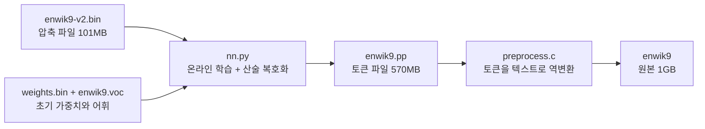

# tufazip: 트랜스포머 압축기를 읽고 직접 돌려 보기


이 글([https://github.com/Tufalabs/tufazip](https://github.com/Tufalabs/tufazip))은 Tufa Labs의 Tommy He가 공개한 tufazip v2 저장소를 다룬 글이에요. 두 가지를 적었어요.

* 작은 파일(『모비 딕』 앞 250KB)을 DGX Spark에서 직접 압축하고 풀어 본 실험 방식과 결과
* 코드를 읽고 정리한 동작 방식

enwik9 공식 결과를 재현한 것은 아니에요. 공식 실행에는 NVIDIA B200 GPU 2장이 필요하고 압축을 푸는 데만 약 7.5일이 걸려요. 코드에 없는 배경과 실험 수치는 [Tufa Labs 블로그 글](https://tufalabs.ai/research/tufazip)을 참고했어요.


### Introduce

tufazip은 1GB짜리 위키백과 덤프인 enwik9를 약 101MB로 줄이는 무손실 압축기예요. Matt Mahoney가 20년째 운영하는 Large Text Compression Benchmark(LTCB)에 제출하려고 만든 프로그램이에요.

enwik9는 2006년 3월 영어 위키백과 덤프의 앞 10억 바이트를 잘라 낸 파일이에요. 본문뿐 아니라 XML 태그와 위키 문법이 그대로 들어 있고, LTCB의 기준 데이터로 쓰여요. 같은 덤프의 앞 1억 바이트만 자른 enwik8도 있어요.

예측 모델은 트랜스포머 하나뿐이에요. 상위권 압축기들은 보통 예측기 수백\~수천 개를 섞어 쓰는데(cmix v21은 2,077개), tufazip은 1억 6천만 개 파라미터짜리 트랜스포머가 다음 토큰의 확률을 예측하고, 그 확률로 산술 부호화를 해요.

저장소에는 압축을 푸는 디코더 실행 스크립트만 있어요. 압축 모드 코드는 `nn.py` 안에 있지만 실행 스크립트는 없어요. 그리고 이 디코더가 하는 일의 대부분은 모델 학습이에요.

### 직접 해 보기: 다른 파일 압축

enwik9가 아닌 파일도 압축되는지 확인하려고, 저작권이 끝난 『모비 딕』 영어 텍스트의 앞 250,000바이트를 압축했다가 풀어 보았어요.

#### 실험 방식

공식 환경이 아니라서 세 가지를 바꿨어요. 저장소 파일은 고치지 않았어요.

| 항목     | 내용                                                                                               |
| ------ | ------------------------------------------------------------------------------------------------ |
| 장비     | NVIDIA DGX Spark (GB10 GPU 1장, aarch64), PyTorch 2.11.0+cu130                                    |
| 실행 방법  | `tufazip` 스크립트 대신 `nn.py`의 `main()`을 직접 호출. 설정(`V2_CONFIG`)에서 `distributed`만 꺼서 GPU 1장으로 실행      |
| 토큰화    | 저장소의 어휘 파일(`enwik9.voc`)에서 가장 긴 항목부터 맞추는 토크나이저를 따로 작성. 저장소의 전처리기(`preprocess d`)로 원본이 복원되는 것을 확인 |
| 나머지 설정 | `V2_CONFIG` 그대로. 사전 가중치 `weights.bin` 사용                                                         |

순서는 이렇게 했어요.

1. 텍스트를 토큰 파일로 바꾸고, 전처리기로 되돌려 원본과 같은지 확인
2. `nn.py`로 토큰 파일을 압축
3. 같은 장비에서 `nn.py`로 압축을 풀고, 토큰 파일과 최종 텍스트가 원본과 같은지 확인
4. 같은 파일을 gzip, bzip2, xz, zstd로 압축해 크기 비교

#### 실험 결과

250,000바이트는 97,314토큰이 됐고, 온라인 학습 1,521스텝으로 처리됐어요.

| 압축기                  | 결과 (바이트) | bits/byte |
| -------------------- | -------- | --------- |
| tufazip v2 (`nn.py`) | 63,275   | 2.02      |
| bzip2 -9             | 82,639   | 2.64      |
| xz -9e               | 90,448   | 2.89      |
| zstd --ultra -22     | 91,883   | 2.94      |
| gzip -9              | 101,828  | 3.26      |

* 압축에 1,694초, 해제에 1,698초가 걸렸어요. 스텝당 약 1.1초예요.
* GPU 메모리는 최대 17.9GB가 할당됐어요.
* 해제한 파일의 SHA-256이 원본과 같았어요. 같은 장비에서는 압축과 해제의 로그 수치도 스텝마다 똑같이 나왔어요.
* 앞 50,000바이트만 압축했을 때는 14,246바이트(2.28 bits/byte)였고, bzip2 -9는 19,114바이트였어요.

아래 표는 압축이 진행되면서 토큰당 비트가 줄어드는 모습이에요. 모델이 압축하면서 학습하기 때문에 뒤로 갈수록 예측이 나아져요.

| 스텝       | 구간 bits/token | 누적 bits/byte |
| -------- | ------------- | ------------ |
| 200      | 6.10          | 2.37         |
| 600      | 5.20          | 2.17         |
| 1000     | 5.02          | 2.09         |
| 1400     | 4.85          | 2.03         |
| 1521 (끝) | 4.94          | 2.02         |

#### 이 결과를 읽을 때 주의할 점

* 압축 파일 63,275바이트에는 디코더와 가중치가 포함되지 않았어요. 디코더 ZIP은 4,356,648바이트로 원본 파일보다 17배 커요.
* 파일이 블록 하나(50만 토큰)보다 작아서, 이미 처리한 데이터를 다시 학습하는 복습(replay) 단계는 한 번도 실행되지 않았어요. 복습은 5절에서 설명해요.
* 사전 가중치와 어휘는 enwik9에 맞춰진 것이고, 토큰화 방식도 원래 전처리기와 달라요.
* GPU 1장, 다른 아키텍처, 다른 PyTorch 버전이라서 이 압축 파일은 같은 장비에서만 풀 수 있다고 봐야 해요.
* enwik9 결과(약 0.81 bits/byte)와 직접 비교할 수 있는 수치는 아니에요.

아래부터는 저장소의 공식 수치와 코드를 읽고 정리한 내용이에요.

***

### 한눈에 보기: enwik9 공식 수치

| 항목         | 내용                                                         |
| ---------- | ---------------------------------------------------------- |
| 압축 결과      | enwik9 1,000,000,000바이트 → 100,958,324바이트                   |
| 디코더 ZIP    | 4,430,029바이트 (가중치와 어휘 파일 포함)                               |
| 벤치마크 점수    | 두 값을 더한 105,388,353바이트                                     |
| 압축 / 해제 시간 | 약 631,548초 / 약 645,748초 (각각 약 7.3일, 7.5일)                  |
| 하드웨어       | NVIDIA B200 GPU 2장, Linux x86-64                           |
| 런타임        | Python 3.12.3, PyTorch 2.12.0+cu130, CUDA 13.0, cuDNN 9.20 |
| 방식         | 양자화한 오프라인 사전 가중치(Cycle2)로 시작해 온라인으로 학습하는 트랜스포머             |
| 라이선스       | MIT                                                        |

LTCB 점수는 압축 파일 크기에 디코더 ZIP 크기를 더한 값이에요. 그래서 모델 가중치를 미리 학습해서 넣으면 그 크기만큼 점수에서 손해를 봐요.

***

### 1. 저장소 구성

| 파일                    | 크기    | 역할                                                |
| --------------------- | ----- | ------------------------------------------------- |
| `tufazip`             | 5.8KB | 실행 스크립트. 파일과 환경을 검증하고, 디코딩과 역변환을 차례로 실행           |
| `nn.py`               | 84KB  | 트랜스포머 모델, 가중치 아카이브 읽기, 온라인 학습과 산술 부호화 루프          |
| `arithmetic_coder.py` | 14KB  | 산술 부호화기 (Project Nayuki의 참조 구현 기반)                |
| `checkpoint_utils.py` | 4.5KB | 중단했다가 이어서 실행하기 위한 체크포인트 저장                        |
| `preprocess.c`        | 31KB  | 텍스트와 토큰을 서로 바꾸는 전처리기 (Fabrice Bellard의 NNCP 전처리기) |
| `enwik9.voc`          | 34KB  | 토큰 4,097개짜리 어휘 파일                                 |
| `weights.bin`         | 4.3MB | 1비트로 양자화한 초기 가중치                                  |

***

### 2. 압축을 푸는 과정

`tufazip` 스크립트를 따라가 보면 과정은 이렇게 돼요.

1. 압축 파일, 어휘 파일, 가중치 파일의 크기와 SHA-256을 확인해요.
2. Python, NumPy, PyTorch, CUDA, cuDNN 버전과 GPU가 B200 2장인지 확인해요. 하나라도 다르면 실행을 거부해요.
3. `torch.distributed.run`으로 `nn.py`를 GPU 2장에 띄워 토큰 파일(`enwik9.pp`)을 복원해요.
4. `preprocess.c`를 GCC로 컴파일해서 토큰 파일을 원본 텍스트로 되돌려요.
5. 결과 파일의 SHA-256이 원본 enwik9와 같은지 확인해요.

토큰 파일은 570,405,660바이트이고 토큰 하나가 2바이트라서, enwik9는 약 2억 8,520만 개의 토큰이 돼요. 토큰 하나가 평균 3.5바이트 정도를 담는 셈이에요.

***

### 3. 핵심 아이디어: 디코더가 같은 학습을 반복한다

일반적인 신경망 압축은 학습된 모델을 압축 파일과 함께 보내야 해요. 그런데 tufazip의 모델은 1억 6천만 파라미터라서, 그대로 보내면 모델이 압축 파일보다 커져요.

그래서 tufazip은 모델을 보내지 않아요. 대신 인코더와 디코더가 **완전히 같은 학습을 반복**해요.

* 인코더는 지금까지 본 토큰으로 다음 토큰의 확률을 예측하고, 실제 토큰을 그 확률로 부호화해요. 그다음 그 토큰으로 모델을 한 스텝 학습해요.
* 디코더는 같은 모델로 같은 확률을 계산해서 토큰을 복호화해요. 그리고 방금 복원한 토큰으로 똑같이 한 스텝 학습해요.

양쪽이 같은 초기 가중치에서 시작해 같은 데이터로 같은 순서로 학습하니까, 매 순간 모델이 똑같아요. 모델이 텍스트를 잘 예측할수록 토큰당 필요한 비트가 줄어들어요.

다만 이게 성립하려면 부동소수점 연산 결과가 비트 단위까지 같아야 해요. 확률이 조금이라도 다르면 그 뒤로는 전부 다르게 복호화돼요. 압축 해제에 7.5일이 걸리는 이유도 여기에 있어요. 디코더가 인코더와 같은 양의 학습을 그대로 다시 해야 하거든요.

***

### 4. 모델

`nn.py`의 `V2_CONFIG`에 실제 제출에 쓴 설정이 고정되어 있어요.

| 항목        | 값                                           |
| --------- | ------------------------------------------- |
| 구조        | 디코더 전용 트랜스포머 12층                            |
| 크기        | `d_model` 1024, 헤드 8개, FFN 내부 차원 2816       |
| 파라미터      | 162,585,600개                                |
| 어휘 / 컨텍스트 | 토큰 4,097개 / 192토큰                           |
| 위치 정보     | RoPE                                        |
| 정규화       | RMSNorm을 각 서브레이어 앞뒤에 적용(peri), 어텐션에 QK-Norm |
| FFN       | SwiGLU                                      |
| 임베딩       | 입력과 출력 임베딩을 따로 둠                            |
| 연산 정밀도    | bf16 autocast                               |

컨텍스트는 192토큰이에요. 블로그 글에 따르면 여러 설정을 실험해서 고른 값이에요.

***

### 5. 온라인 학습 루프

`nn.py`의 메인 루프는 토큰 50만 개 단위의 블록으로 진행돼요. enwik9는 전체가 약 570블록이에요.

#### 부호화하면서 학습

블록 하나를 64개의 스트림으로 나눠서 동시에 처리해요. 스트림마다 한 토큰씩 앞으로 가면서 아래를 반복해요.

1. 직전 최대 192토큰을 넣어 다음 토큰의 로짓을 계산
2. 소프트맥스 확률을 합계 10,000,000짜리 정수 빈도표로 바꿔 32비트 산술 부호화기에 전달
3. 디코더는 이 빈도표로 토큰 64개를 복호화
4. 방금 처리한 토큰 64개만 정답으로 삼아 Adam으로 한 스텝 학습

공식 실행에서는 GPU 2장이 스트림을 32개씩 나눠 맡고, 산술 부호화는 0번 프로세스가 모아서 처리해요.

#### 블록마다 복습(replay)

두 번째 블록부터는 블록을 시작하기 전에 `retrain` 함수가 실행돼요. 이미 복원한 최근 3,500만 토큰을 다시 한 번 학습하는 단계예요.

* 이미 양쪽이 가지고 있는 데이터만 쓰기 때문에 디코더도 똑같이 재현할 수 있음
* 이때만 드롭아웃 0.25를 켬 (부호화 중에는 eval 모드)
* 배치 32, 한 번에 64토큰씩 업데이트
* 온라인 학습용 Adam과 분리된 별도의 옵티마이저 사용

블로그 글에 따르면 복습 범위를 1,500만에서 3,500만 토큰으로 늘렸을 때 압축 파일이 107.22MB에서 105.92MB로 줄었고, 계산량은 약 40% 늘었어요.

옵티마이저는 두 단계 모두 Adam이고 `beta1`이 0이라 모멘텀이 없어요. 그래디언트 클리핑은 0.25, 온라인 학습률은 4e-05에서 코사인으로 줄어들어요.

***

### 6. weights.bin: 1비트로 양자화한 2층짜리 사전 가중치

v1은 무작위 초기화에서 시작했는데, v2는 미리 학습한 가중치(`weights.bin`)에서 시작해요. 파일 헤더의 메타데이터는 이렇게 되어 있어요.

| 항목     | 값                                               |
| ------ | ----------------------------------------------- |
| 형식     | `QPI1` 아카이브 (JSON 메타데이터 + 비트 패킹된 텐서)            |
| 저장된 모델 | 2층짜리 트랜스포머, 약 3,409만 파라미터                       |
| 양자화    | 행렬 가중치는 1비트(부호만 저장), 행마다 fp16 스케일 하나            |
| 나머지    | 정규화 가중치 같은 작은 텐서는 8비트                           |
| 초기화 종류 | `loop-untying`, 블록 순서 `0,1,0,1,0,1,0,1,0,1,0,1` |

저장된 건 블록 A와 B 두 개예요. 디코더는 이걸 ABABABABABAB 순서로 12층에 복사해서 시작해요. 블로그에서는 이 배치를 Cycle2라고 불러요. 복사된 12개 층은 그때부터 서로 독립적으로 학습돼요.

3,400만 개 가중치를 1비트로 저장하니 파일은 4.3MB예요.

블로그 글의 수치를 보면 v2는 v1보다 압축 파일이 4.97MB 줄었지만 디코더가 4.38MB 커져서, 총점 이득은 0.59MB(0.56%)예요. 6층짜리 사전 가중치는 예측은 더 잘했지만 파일이 10.9MB라 총점에서는 손해였다고 해요.

***

### 7. 결정론을 지키는 장치

인코더와 디코더의 연산이 비트 단위로 같아야 하기 때문에, 코드에 이를 위한 장치가 있어요.

* `torch.use_deterministic_algorithms(True)`와 `CUBLAS_WORKSPACE_CONFIG`, `NCCL_ALGO=Ring`, `OMP_NUM_THREADS=1` 같은 환경 변수 고정
* 라이브러리 버전과 GPU 모델명까지 검사해서 다르면 실행 거부
* 입력 파일, 중간 토큰 파일, 최종 결과의 SHA-256 검증
* 시드 1111 고정. 가중치 초기화 뒤에는 GPU 프로세스별로 `seed + rank`를 써서 드롭아웃 난수를 재현

중단에 대비한 체크포인트도 있어요. 모델과 두 옵티마이저 상태, 프로세스별 난수 상태, 산술 부호화기와 비트 스트림 상태, 출력 파일 위치를 저장해요. 파일은 임시 파일에 쓴 뒤 `fsync`하고 이름을 바꾸는 방식으로 원자적으로 저장해요. Ctrl+C를 누르면 다음 체크포인트에서 멈추고, 같은 명령을 다시 실행하면 이어서 진행돼요.

***

### 8. 공식 결과와 한계

| 프로그램       | enwik9 총점 (바이트) | 비고                   |
| ---------- | --------------- | -------------------- |
| tufazip v2 | 105,388,353     | 오프라인 사전 가중치 + 온라인 학습 |
| tufazip v1 | 105,979,069     | 온라인 학습만 사용           |
| nncp v3.2  | 107,261,318     | 같은 계열의 선행 연구         |
| cmix v21   | 108,244,767     | 예측기 2,077개를 섞는 방식    |

블로그 글은 제출 시점(2026년 9월 7일)에 LTCB 2위였고, 신경망 하나만 쓰는 방식 중에서는 최고 기록이라고 밝혀요. 지금 LTCB 표에는 그 뒤에 올라온 더 작은 기록들이 있어요.

한계는 다음과 같아요.

* 압축과 해제에 B200 GPU 2장으로 각각 약 7.3일, 7.5일이 걸림
* B200 2장과 고정된 라이브러리 버전이 아니면 스크립트가 실행을 거부해서, 그 환경 없이는 enwik9 압축을 풀거나 결과를 검증할 수 없음
* 저장소에는 디코더 실행 스크립트만 있음. `nn.py`에 압축 모드 코드는 있지만, 압축용 실행 스크립트와 사전 가중치를 학습·양자화하는 코드는 없음
* `preprocess.c`는 새 어휘를 만드는 모드와 복원 모드만 있고, 기존 `enwik9.voc`로 다른 파일을 토큰화하는 기능은 없음
* `nn.py`에 Mamba, KDA 백엔드 옵션이 있지만 필요한 파일(`ssm_models.py`, `kda_models.py`)은 저장소에 없음
* 오프라인 사전 가중치로 얻은 총점 이득은 v1 대비 0.56%
* 블로그 글에 따르면 모델을 1억 8,800만, 2억 6,700만 파라미터로 키워도 enwik9 결과가 나아지지 않았음

### Summary

> tufazip은 모델을 보내는 대신 디코더가 인코더와 똑같은 학습을 반복하게 해서, 트랜스포머 하나로 enwik9를 101MB까지 줄였어요.\
> 직접 돌려 보니 『모비 딕』 250KB는 63,275바이트로 줄었고(bzip2 -9는 82,639바이트), GPU 1장으로 압축과 해제에 각각 약 28분이 걸렸어요.

### Reference






